# Design

## 1. Introduction

This document records the design phase of the project: the alternatives we sketched, the storyboard, the wireframes for all three study conditions, the clickable low-fidelity prototype and the reasons behind our design decisions.

The design builds on the [User Requirements](../Research/user_requirements.md) and covers both scenarios defined there:

- **Scenario A:** the user asks the AI agent to summarise a client's file and flag anything that differs from last year, then checks the summary against the original documents.
- **Scenario B:** the user approves, edits or rejects the agent's draft, completes a sign-off step and gets an audit record of who decided what.

Conditions A (plain answer) and B (answer with evidence) are defined by the project brief. Alternatives were therefore explored only for Condition C, our own design.

## 2. Alternatives Considered for Condition C

We sketched three different approaches before choosing one.

### 2.1 Alternative 1: Claim Queue

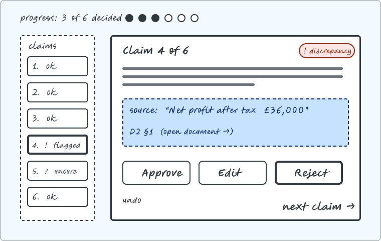

The summary is split into claim cards. The reviewer decides one claim at a time, with the source quoted on the card. Inspired by the review queues in Full Fact AI and Factiverse.

| Strengths | Risks |
|---|---|
| Forces a decision on every claim (`UR-01`, `UR-05`) | Loses the flow of the summary as prose |
| Clear progress and a natural place for sign-off (`UR-07`) | Slow when there are many claims |
| Every action is easy to log (`UR-08`) | A quoted snippet hides the rest of the document |

### 2.2 Alternative 2: Split-Screen Evidence

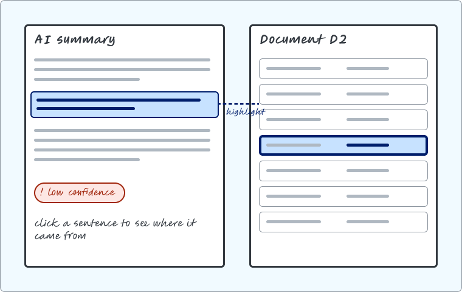

The summary is on the left and the documents are on the right. Clicking a sentence highlights the passage it came from. Inspired by Adobe Acrobat AI Assistant and Anara.

| Strengths | Risks |
|---|---|
| Fastest route from a claim to its evidence (`UR-02`) | Easy to skim and skip sentences |
| Keeps the whole document in view | No decision per claim and no undo trail |
| Familiar from existing tools | No natural sign-off step or audit record |

### 2.3 Alternative 3: Changes First

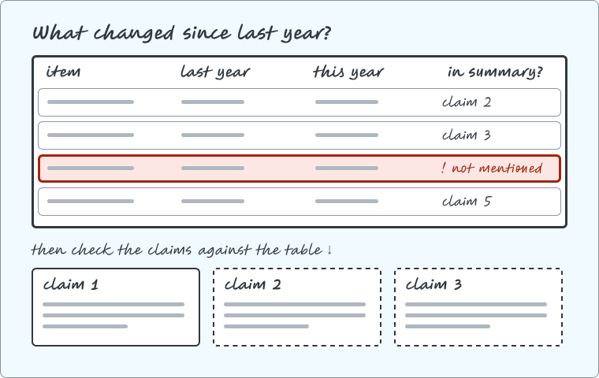

The reviewer starts from a table of what changed between last year and this year, then checks the summary against it. Inspired by ABBYY FineReader's compare view and Litera Kira.

| Strengths | Risks |
|---|---|
| Directly supports "flag what differs from last year" (`UR-06`) | Covers only year-on-year facts |
| Makes omissions visible | The table can dominate the task |
| Gives an overview before detailed checking | Most to build; a stretch goal in our plan |

### 2.4 Comparison Against Requirements

| Criterion | 1 · Claim queue | 2 · Split-screen evidence | 3 · Changes first |
|---|---|---|---|
| Find errors claim by claim (`UR-01`) | Strong | Partial | Partial |
| Jump from a claim to its evidence fast (`UR-02`) | Partial | Strong | Weak |
| Spot changes from last year and omissions (`UR-06`) | Weak | Partial | Strong |
| Approve, edit, reject and undo per claim (`UR-05`) | Strong | Weak | Weak |
| Sign-off gate and audit record (`UR-07`, `UR-08`) | Strong | Weak | Partial |
| Keeps workload manageable (`UR-09`) | Partial | Strong | Partial |
| Effort to build | Low | Medium | High |

## 3. Chosen Design

No single alternative covers all requirements, so we chose a **hybrid**:

- the **claim queue** (Alternative 1) for decisions, progress and sign-off;
- placed next to a **document viewer with highlighted sources** (Alternative 2);
- with the **changes table** (Alternative 3) as a second tab, if time allows.

## 4. Storyboard

Maya is a credit analyst at a commercial bank. Panels 1–5 follow Scenario A and panel 6 follows Scenario B.

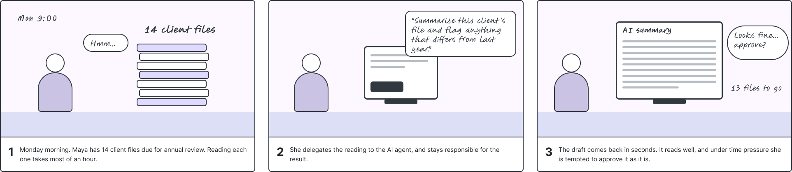

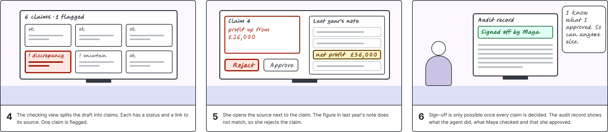

1. Maya has 14 client files due for annual review. Reading each one takes most of an hour.
2. She delegates the reading to the AI agent, and stays responsible for the result.
3. The draft comes back in seconds. It reads well, and under time pressure she is tempted to approve it as it is.
4. The checking view splits the draft into claims. Each has a status and a link to its source. One claim is flagged.
5. She opens the source next to the claim. The figure in last year's note does not match, so she rejects the claim.
6. Sign-off is only possible once every claim is decided. The audit record shows what the agent did, what Maya checked and that she approved.

## 5. Wireframes

All wireframes use the practice client file (Lark & Lantern Bakery Ltd), so none of the three study files is shown. The summary text, the documents and the planted mistakes are identical in all three conditions; only the interface changes.

### 5.1 Condition A: Plain Answer

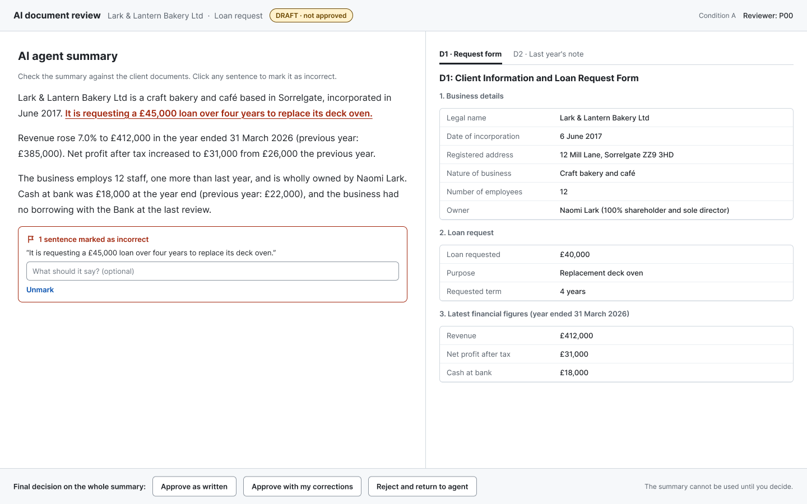

- Shows only the AI summary as prose, with the documents in tabs on the right.
- Nothing links a sentence to a passage; the reviewer must search by hand.
- A sentence can be clicked to mark it as incorrect. This lets us compare error detection with Conditions B and C; it adds no evidence.

### 5.2 Condition B: Answer with Evidence

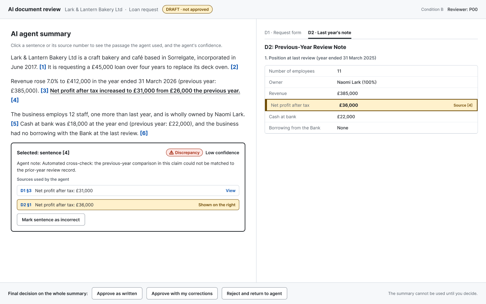

- The same summary, with a numbered source link on each sentence.
- Clicking a sentence shows the passages the agent used, highlights the passage in the document viewer and shows the agent's confidence note (`UR-02`, `UR-04`).
- No claim-by-claim approval, no sign-off gate and no audit record.

### 5.3 Condition C: Checking Workflow

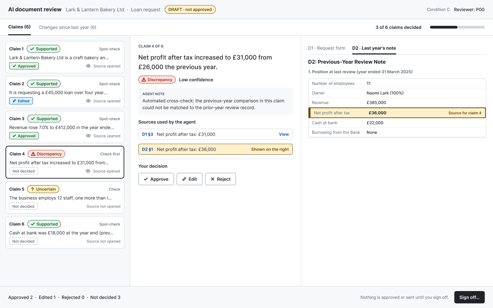

- **Claim queue (left):** one card per claim with a status badge (*Supported*, *Uncertain*, *Discrepancy*), a checking hint and the reviewer's decision so far.
- **Claim detail (middle):** the full claim, the agent's note, the sources used and the *Approve*, *Edit* and *Reject* buttons with undo (`UR-05`).
- **Document viewer (right):** the source passage for the selected claim, highlighted (`UR-02`).
- Status badges and highlights use an icon, a text label and a border, never colour alone (`SR-02`).

**Sign-off is blocked** while any claim is undecided or a flagged claim has not been checked against its source (`SR-01`):

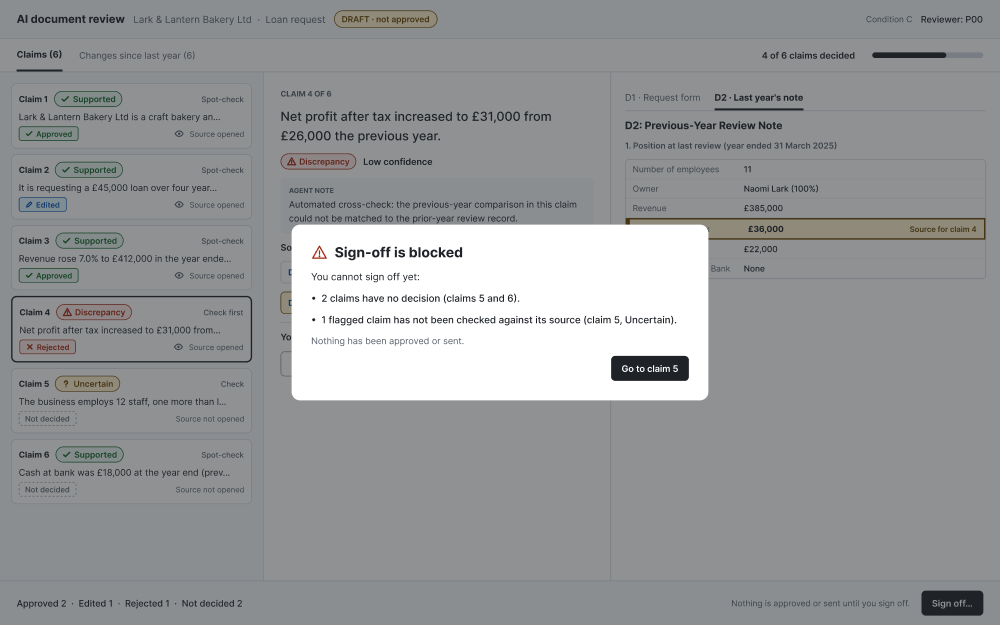

**The sign-off dialog** asks for a final decision and a statement that the reviewer, not the AI agent, is responsible (`UR-07`):

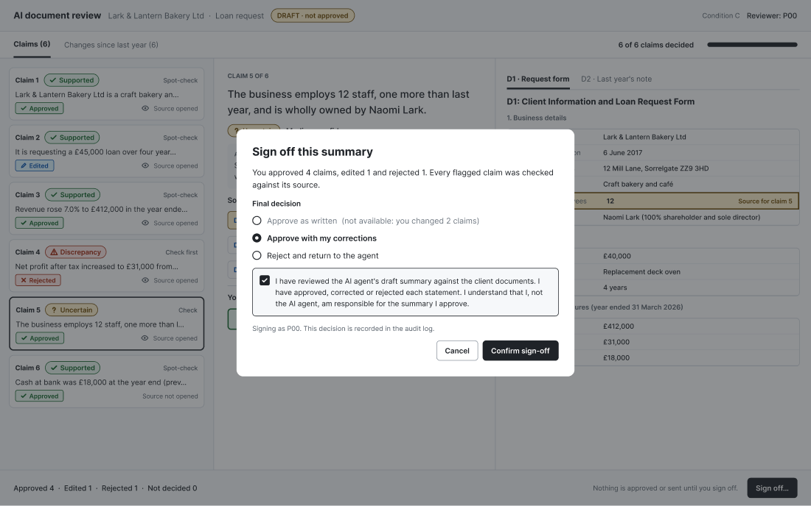

**The audit record** shows what the agent produced, what the reviewer opened and decided, and who signed off, in a form a third person can read (`UR-08`):

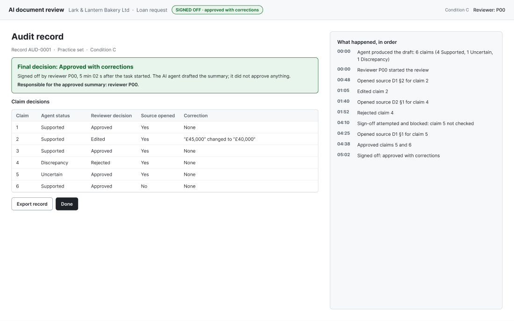

**The "changes since last year" tab** is built from the documents, not from the AI summary (`UR-06`). It is a stretch feature:

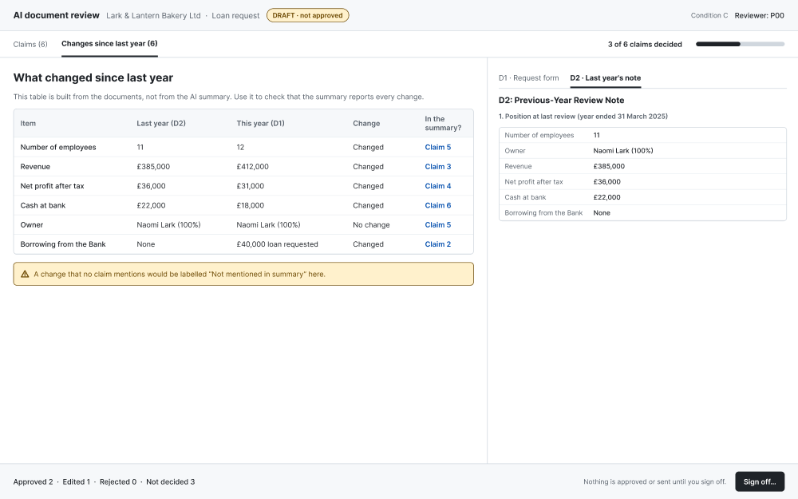

## 6. Design Rationale

| Design decision | HCI principle | Evidence from our research | Requirement |
|---|---|---|---|
| Summary split into claims, one decision each | User control and freedom | Fluent prose is over-trusted (Bansal *et al.*, 2021); decision control improves engagement (Westphal *et al.*, 2023) | `UR-01`, `UR-05` |
| Source shown next to the claim, highlighted | Verifiability; recognition rather than recall | Fok and Weld (2024); Adobe Acrobat AI Assistant, Anara | `UR-02` |
| Status shown as icon, label and border | Not colour alone (WCAG 2.1, 1.4.1) | Uncertainty and inconsistency cues (Kim *et al.*, 2024; Kim *et al.*, 2025) | `UR-03`, `UR-04`, `SR-02` |
| Sign-off blocked until flagged claims are checked | Error prevention (Nielsen, 1994) | Compliance review tools such as Spektr | `UR-07`, `SR-01` |
| Readable audit record after sign-off | Visibility of system status; accountability | Balakayeva *et al.* (2025); the brief's audit-trail requirement | `UR-08` |
| Short agent notes instead of long explanations | Manageable workload | Long explanations raise workload without helping (Westphal *et al.*, 2023) | `UR-09` |

Full references are in the [Literature Review](../Research/literature_review.md) and the [Analysis of Existing Solutions](../Research/analysis_of_existing_solutions.md).

## 7. Low-Fidelity Prototype Test

The Condition C wireframes are linked into a clickable prototype in Figma (see Section 8). We tested it with two people before starting implementation.

**Method**

- Think-aloud with 2 people on the clickable prototype, using the practice client file.
- Task 1: find the claim that does not match its source.
- Task 2: try to sign off.
- Task 3: say who is responsible for the approved summary.

**Results**

| | |
|---|---|
| Participants | 2 |
| Tasks completed | Both participants completed all three tasks. |
| Problems observed | None. No changes to the wireframes were needed. |
| What worked well | The decision section: approving, editing or rejecting each claim was clear. |
| What worked well | The sign-off gate: participants could not sign off while claims were still unchecked, and understood why. |

**What this means for the design**

- We keep the chosen hybrid design and take it into implementation unchanged.
- The two parts that worked best, the per-claim decisions (`UR-05`) and the blocked sign-off (`UR-07`, `SR-01`), are the core of Condition C, so they are built first.

## 8. Links

- **Figma file:** [sketches](https://www.figma.com/design/dOLpd4oGbaVSfFUxDLT88k/design?node-id=0-1), [storyboard](https://www.figma.com/design/dOLpd4oGbaVSfFUxDLT88k/design?node-id=6-2), [wireframes and prototype](https://www.figma.com/design/dOLpd4oGbaVSfFUxDLT88k/design?node-id=6-3)
- **Clickable prototype:** open the wireframes page, press *Present* and choose the flow "Condition C click-through". Path: *Reject* → *Sign off* → *Go to claim 5* → *Approve* → *Sign off* → *Confirm sign-off*.
- **User flow diagram:** [figjam link](https://www.figma.com/board/mjEV9RE3pDwj4Hir6HfWH3/User-flow---delegate--check--sign-off--HCI-Project-06-?node-id=0-1&t=iKEB6jGNkSKhoE1t-1)

## 9. What Is Simulated

- The AI agent is simulated with pre-written summaries that contain planted mistakes.
- The client documents are synthetic. No real client data is used.
- In the clickable prototype, the claim decisions are pre-filled; only one path through the screens is linked.

## 10. Declaration of AI Usage

CLaude AI was used as a supporting tool throughout the design phase for the following purposes:

- Brainstorming the user flow
- Suggesting ideas for Condition C.
- Drawing the storyboard panels.
- Drafting wireframes for Conditions A, B and C.

